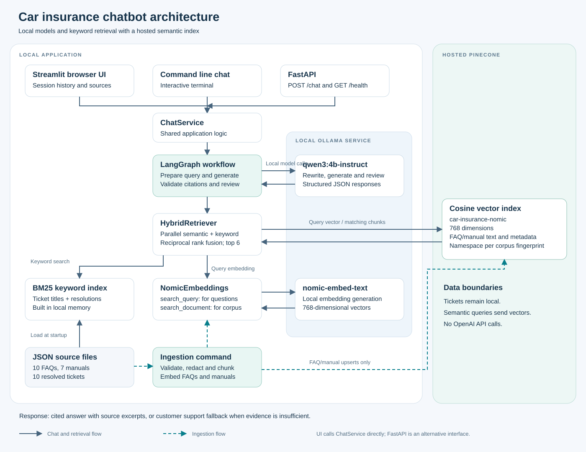
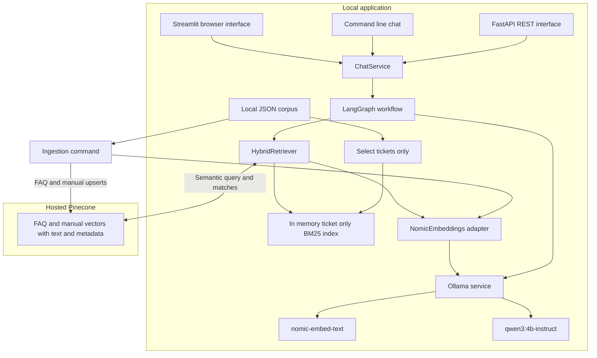
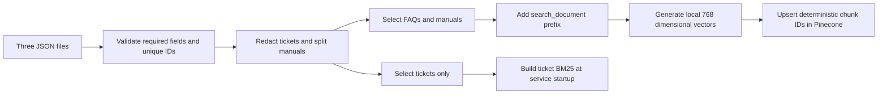
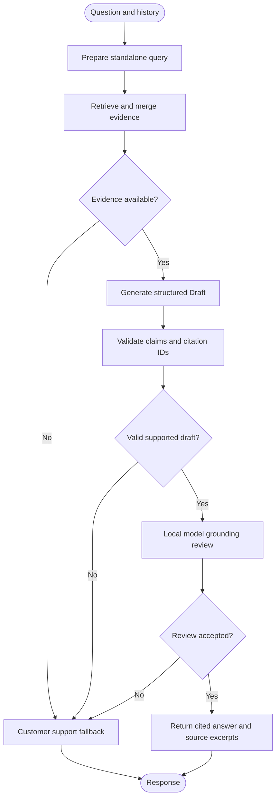

# Car Insurance Chatbot Project Documentation

This project provides a car insurance support chatbot with source citations and a customer support fallback. It combines semantic retrieval over FAQs and manuals with keyword retrieval over resolved tickets, then uses a local language model to draft and review answers.

The application runs locally through Streamlit, a command-line chat, or FastAPI. Both language models run through Ollama. Pinecone is the hosted dependency for vector storage and semantic search; an internet connection and Pinecone API key are required. OpenAI API access is not used by the current implementation.

## Architecture



[Open the architecture diagram](docs/architecture.svg). Solid arrows show chat and retrieval; dashed teal arrows show ingestion.

### Editable Mermaid diagram



The Streamlit interface calls `ChatService` directly; it does not call the REST API. FastAPI and the CLI are alternative entry points into the same service. The evaluation runner constructs the same retriever and graph directly so it can capture retrieved sources and graph state.

### Responsibilities

| Component | Responsibility | Implementation |
|---|---|---|
| Streamlit | Suggested questions, session history, answer display, expandable citations, reset and fallback states | [ui.py](insurance_bot/ui.py), [streamlit_app.py](streamlit_app.py) |
| FastAPI | Input validation and HTTP access to chat | [api.py](insurance_bot/api.py) |
| Command line | Data validation, ingestion and terminal chat | [__main__.py](insurance_bot/__main__.py) |
| Service | Initialize retrieval and graph; translate runtime exceptions into availability fallbacks | [service.py](insurance_bot/service.py) |
| Settings | Load environment and `.env` settings with validation | [config.py](insurance_bot/config.py) |
| Data preparation | Validate records, redact ticket patterns, split manuals, preserve metadata | [data.py](insurance_bot/data.py) |
| Embedding adapter | Add Nomic retrieval prefixes and verify vector dimensions | [embeddings.py](insurance_bot/embeddings.py) |
| Hybrid search | Parallel semantic and BM25 retrieval, filtering and rank fusion | [retrieval.py](insurance_bot/retrieval.py) |
| Workflow | Follow-up rewriting, generation, citation validation, grounding review and fallback | [graph.py](insurance_bot/graph.py) |
| Evaluation | Execute labeled queries and save metrics and answers | [evaluate.py](insurance_bot/evaluate.py) |

## Data and ingestion

The supplied corpus has 10 FAQ records, 7 manual records and 10 resolved ticket records. The seven supplied manuals currently produce seven chunks, so the indexed FAQ/manual corpus contains 17 vectors. Counts can change when documents are updated.

| Dataset | Semantic retrieval | BM25 retrieval | Treatment |
|---|---|---|---|
| [FAQs](data/car_insurance_faqs.json) | Pinecone | Not indexed | One document per FAQ |
| [Manuals](data/car_insurance_manuals.json) | Pinecone | Not indexed | Recursive splitting at 1,000 characters with 150-character overlap |
| [Tickets](data/car_insurance_tickets.json) | Not indexed | Local memory | One document per ticket; email and long numeric patterns redacted |

Records require non-empty string `id`, `title` and `content` fields. IDs must be unique across the three files. Source type is assigned from the configured filename mapping. Document text combines the title and content. Each chunk carries `source_id`, `chunk_id`, `source`, `title` and `file` metadata. A citation such as `[insurance-faq-004:0]` identifies the original record and its zero-based chunk position.



### Embeddings and index lifecycle

`nomic-embed-text` generates 768-dimensional vectors locally. Documents are prefixed with `search_document: ` and questions with `search_query: `. The adapter rejects vectors whose dimensions differ from `EMBEDDING_DIMENSIONS`.

The configured Pinecone index is `car-insurance-nomic`, with cosine similarity and 768 dimensions. Ingestion can create the index if missing. Normal chat startup requires it to exist. Index initialization checks local Ollama connectivity and vector dimensions, verifies Pinecone configuration, and waits up to 120 seconds for index readiness.

A namespace named `insurance-<fingerprint>` is derived from FAQ/manual chunk text and metadata, the embedding model name, dimensions and a prefix-version marker. Updating this content changes the namespace and requires ingestion before semantic retrieval will find the new vectors. Existing namespaces are retained. Ticket-only changes do not change the namespace, but require service restart to rebuild BM25.

The fingerprint uses the model name rather than a model-weight digest. Replacing model weights under the same tag requires deliberate re-indexing and namespace/version management. Changing only the chat model does not require re-indexing.

The older `faqsandmanuals` index uses 512 dimensions and is incompatible with the current 768-dimensional configuration. The migration preserved that index; the application does not automatically delete indexes or old namespaces.

## Retrieval architecture

1. The graph receives a question. With history, the local chat model rewrites it into a standalone search query using up to eight prior messages. Without history, the original question is used.
2. Two retrieval branches run concurrently: Pinecone semantic search over FAQ/manual vectors and BM25 keyword search over ticket documents only.
3. Semantic matches below `SEMANTIC_MIN_SCORE` are excluded. Unknown chunk IDs are ignored; known hits are resolved to the current local document text.
4. BM25 lowercases and tokenizes alphanumeric terms, removes a fixed stopword list, and returns positive-scoring documents with query-term overlap.
5. Reciprocal rank fusion merges the lists and deduplicates by chunk ID. Each list contributes `1 / (60 + rank)` to a chunk's score. The top `RETRIEVAL_K` chunks are supplied as evidence.

The default `RETRIEVAL_K` is six per branch and six after fusion. Cosine and fusion scores are ranking signals, not calibrated confidence probabilities. FAQs/manuals are designated authoritative in the prompt; the fusion algorithm itself does not apply source authority weights.

Both branches must complete successfully. A semantic-service failure currently produces an availability fallback through `ChatService`, rather than silently continuing with BM25 alone.

## LangGraph answer workflow



`qwen3:4b-instruct` handles query rewriting, generation and review through `ChatOllama`. Generation and review use JSON-schema structured output. The model is configured with temperature zero, an 8,192-token context setting and a 1,200-token prediction limit per call. A supported answer normally requires two model calls, with an additional rewriting call for follow-ups.

The draft schema contains `supported` and a list of claims; each claim has text and exact supporting chunk IDs. Application validation rejects unsupported or empty drafts, empty claim text, missing citations, unknown citations, and model-authored square brackets in claim text. The application adds citation markers and returns source metadata and excerpts.

A second call to the same model checks whether the proposed claims answer the question, follow the cited evidence and avoid conflicts. A rejected review returns a support fallback. These checks reduce unsupported answers but do not guarantee correctness or complete answers.

The prompt instructs the model to treat history and documents as untrusted data, use only evidence, prioritize FAQ/manual authority, treat tickets as examples, and avoid inferring customer-specific coverage or account details. There is no external web search in the chatbot pipeline.

## Interfaces and conversation state

### Browser interface

The Streamlit UI provides suggested questions, user/assistant messages, source expanders, a waiting indicator and conversation reset. `st.cache_resource` caches a shared `ChatService`; each user's messages are stored separately in Streamlit session state. The most recent eight messages are forwarded as history.

The UI creates the service lazily on the first question. It catches initialization failures and shows a generic availability message. User messages and source excerpts are not inserted into the UI's custom HTML; excerpts are displayed with `st.text`. Decorative fonts can load from Google Fonts, with system font fallbacks.

Conversation data is not written to project files by the chat UI. Session state remains in server memory; closing a browser tab does not guarantee immediate deletion. There is no durable conversation store. Restart Streamlit after changing `.env` or data so the cached service reloads.

### REST API

| Endpoint | Purpose |
|---|---|
| `GET /health` | Reports that the app started; does not probe live upstream dependencies |
| `POST /chat` | Accepts a question and optional client-supplied history |
| `/docs` | Interactive FastAPI documentation |

The API initializes `ChatService` during startup. Questions allow up to 2,000 characters and must not be blank. History allows up to eight `user` or `assistant` messages of up to 4,000 characters each. The API does not persist conversation history; clients send it with each request.

Example request:

```json
{
  "question": "What is an auto insurance deductible?",
  "history": []
}
```

Example response shape, with an abbreviated excerpt:

```json
{
  "answer": "A deductible is the amount you may pay toward a covered loss. [insurance-faq-004:0]",
  "citations": [
    {
      "id": "insurance-faq-004:0",
      "source_id": "insurance-faq-004",
      "chunk_id": "insurance-faq-004:0",
      "source": "FAQ",
      "title": "What is an auto insurance deductible?",
      "file": "car_insurance_faqs.json",
      "excerpt": "Supporting source text"
    }
  ],
  "fallback": false,
  "support_phone": null
}
```

Evidence-related fallbacks return no citations and include the configured support number, if present. A missing phone number is stated explicitly. Runtime errors are converted to availability messages; these service fallbacks currently return an HTTP 200 response with `fallback: true`, rather than a distinct HTTP error status. Input validation failures return HTTP 422.

## Configuration

Settings load from the project-root `.env` and environment variables; environment variables take precedence. Unknown settings are ignored. These are the code defaults, not secret values read from the working environment.

| Variable | Default | Purpose |
|---|---|---|
| `PINECONE_API_KEY` | Empty | Required Pinecone authentication |
| `PINECONE_INDEX` | `car-insurance-nomic` | Vector index name |
| `PINECONE_CLOUD` | `aws` | Cloud used when creating an index |
| `PINECONE_REGION` | `us-east-1` | Region used when creating an index |
| `OLLAMA_BASE_URL` | `http://localhost:11434` | Embedding and chat endpoint |
| `EMBEDDING_MODEL` | `nomic-embed-text` | Local embedding model |
| `EMBEDDING_DIMENSIONS` | `768` | Required vector dimensions |
| `CHAT_MODEL` | `qwen3:4b-instruct` | Local answer and review model |
| `CHAT_TIMEOUT` | `300` | Ollama chat HTTP timeout in seconds |
| `CHAT_CONTEXT_SIZE` | `8192` | Chat context window setting |
| `RETRIEVAL_K` | `6` | Results per retriever and final evidence limit |
| `SEMANTIC_MIN_SCORE` | `0.35` | Minimum cosine similarity for semantic matches |
| `CUSTOMER_SUPPORT_PHONE` | Empty | Support fallback contact number |
| `DATA_DIR` | Project `data` directory | Directory containing the three configured JSON files |

Embedding HTTP calls use a separate 120-second timeout in the adapter. Legacy `OPENAI_API_KEY` settings are ignored. Pinecone service usage is subject to the account's own limits and pricing even though model inference is local.

## Setup and operation

Use Python 3.11 for the tested dependency lock. An existing `.venv` is already available in the original workspace. For a fresh checkout with Python 3.11 installed:

```powershell
py -3.11 -m venv .venv
.\.venv\Scripts\python.exe -m pip install -r requirements.lock.txt
# Only create .env if it does not already exist.
if (-not (Test-Path .env)) { Copy-Item .env.example .env }
```

Fill in the Pinecone API key and real customer support phone number in `.env`. Install Ollama and download both models:

```powershell
ollama pull nomic-embed-text
ollama pull qwen3:4b-instruct
```

If Ollama is not already running, run `ollama serve` in a separate terminal. Validate data and ingest FAQs/manuals:

```powershell
.\.venv\Scripts\python.exe -m insurance_bot check-data
.\.venv\Scripts\python.exe -m insurance_bot ingest
```

Ingestion performs remote Pinecone writes and can create an index. Repeated upserts use deterministic chunk IDs. Pinecone is eventually consistent, so allow a short delay after ingestion before searching.

Choose an interface:

```powershell
# Browser UI at http://127.0.0.1:8501
.\.venv\Scripts\python.exe -m streamlit run streamlit_app.py

# Terminal chat; type exit or quit to finish
.\.venv\Scripts\python.exe -m insurance_bot chat

# REST API at http://127.0.0.1:8000/docs
.\.venv\Scripts\python.exe -m uvicorn insurance_bot.api:app --host 127.0.0.1 --port 8000
```

## Tests and evaluation

```powershell
.\.venv\Scripts\python.exe -m pytest -q
.\.venv\Scripts\python.exe -m insurance_bot.evaluate
```

The automated tests cover loading and namespace behavior, retrieval and fusion, citation checks, fallback behavior, model wiring, graph routing, API validation, evaluation calculations, and UI conversations. Model and retriever fakes avoid live inference and Pinecone calls in these tests. The last full test run passed 18 tests; the final UI display update also passed its three focused tests.

The live evaluation dataset has 20 independent queries: 15 answerable and five expected fallbacks. The runner checkpoints JSON after each question and writes CSV on completion under `evaluation/results/`. It records answers, sources, routing, errors, retrieval metrics, phrase-based expected-fact coverage and latency. Additional assistant source-review annotations are separate from the automated runner.

The October 25, 2026 evaluation used the earlier BM25 configuration covering all three sources. Those metrics do not validate the current ticket-only BM25 configuration; rerun evaluation before comparing quality. That run achieved reviewed safe handling of 17/20 (85%), including five correct fallbacks; reviewed answerable resolution was 12/15 (80%). Expected-source hit at six was 100%, and citation reference validity was 100% among returned answers. Median latency was 66.6 seconds and p95 was 94.8 seconds. These are single-run results on a small synthetic dataset, not production first-contact-resolution or general accuracy estimates.

See [the evaluation report](EVALUATION_REPORT.md) for all 20 outcomes, metric definitions, source-review limitations and failure cases. The remaining observed issues include unnecessary claim-filing escalation, incomplete new-car guidance and unsupported customer-specific premium-cause wording.

## Privacy and deployment boundaries

- FAQ/manual embeddings, document text and metadata are stored in hosted Pinecone. Ticket text is not uploaded by ingestion; tickets stay in local BM25 and are supplied to the configured Ollama endpoint when retrieved.
- Customer queries are embedded locally. Query vectors are sent to Pinecone for semantic search. Rewritten queries can include information carried from conversation history.
- Ticket redaction covers email and long numeric patterns only. It is not comprehensive personal-data anonymization and can also redact useful long identifiers.
- Chat logging records exception types rather than questions, source payloads or credentials. Evaluation intentionally persists answers and excerpts and should use non-sensitive test queries.
- `.env`, `.venv`, `.tools` and Python caches are excluded from Git. `.env.example` is a template and should contain no live API keys.
- The supplied Streamlit configuration binds to localhost. The documented API command also binds to localhost. Authentication, authorization, rate limiting and durable audit controls are not implemented for public deployment.

## Troubleshooting

| Symptom | Check and action |
|---|---|
| Ollama connection refused | Start Ollama and confirm `OLLAMA_BASE_URL` reaches the running service |
| Model not found | Pull both configured model tags with `ollama pull` |
| Vector dimension mismatch | Match the model's actual output, `EMBEDDING_DIMENSIONS` and a compatible cosine Pinecone index; do not reuse the old 512-dimensional index |
| Pinecone authentication failure | Verify the `.env` key belongs to the intended project without printing the key |
| Index missing | Run ingestion; ensure the Pinecone plan permits index creation |
| Semantic matches disappear after a data change | Ingest the updated FAQ/manual corpus into its new fingerprint namespace and restart cached services |
| Ticket updates are not reflected | Restart the application to rebuild BM25; ticket-only changes do not require vector ingestion |
| Unnecessary support fallback | Inspect retrieved sources, draft support and citation checks, and grounding-review behavior; evidence retrieval alone does not ensure resolution |
| Temporarily unavailable response | Check Ollama, Pinecone connectivity and timeout conditions; the current service logs the exception type |
| UI uses old settings or data | Restart Streamlit so its cached service reloads |
| Responses take a minute or more | Local inference runs generation plus review, and follow-ups add rewriting; benchmark model/context changes against the evaluation dataset |
| Support fallback has no phone number | Set the verified `CUSTOMER_SUPPORT_PHONE` and restart the application |

## Repository map

```text
CustomerSupportBot/
|-- streamlit_app.py              Browser entry point
|-- .streamlit/config.toml        UI theme and local server configuration
|-- .env.example                  Configuration template
|-- requirements.txt              Dependency ranges
|-- requirements.lock.txt         Tested dependency versions
|-- insurance_bot/                Application, retrieval, models and graph
|-- data/                         FAQ, manual and ticket JSON files
|-- tests/                        Pipeline, evaluation and UI tests
|-- evaluation/queries.json       Labeled 20-query dataset
|-- evaluation/results/           Raw results and reviewed reports
|-- README.md                     Quick start and commands
|-- EVALUATION_REPORT.md          Evaluation findings
|-- PROJECT_DOCUMENTATION.md      Architecture and operation reference
```
